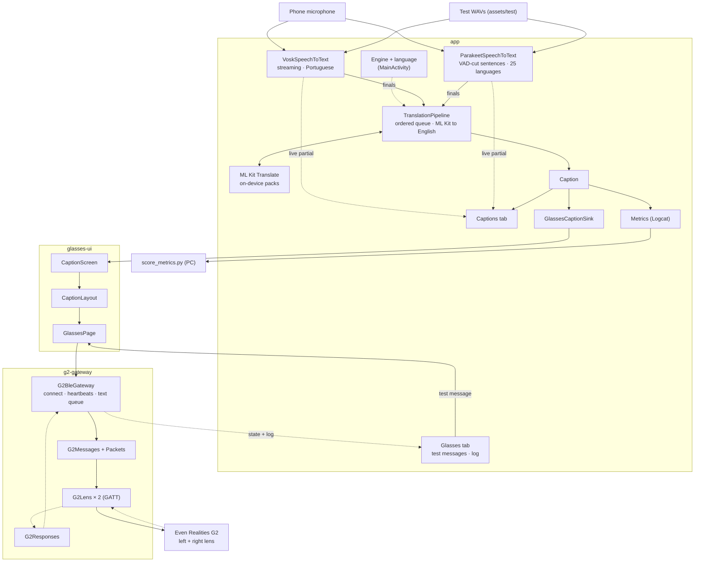

# Architecture

How data moves through the Android app (`G2glasses/`). Boxes are code modules; the subgraphs are
the three Gradle modules. Solid arrows carry speech and captions; dotted arrows carry status and
events back from the glasses.

Interfaces between modules: `SpeechToText` (engines), `CaptionSink` (caption outputs),
`GlassesScreen` (on-glasses UI) and `GlassesGateway` (the BLE link).
